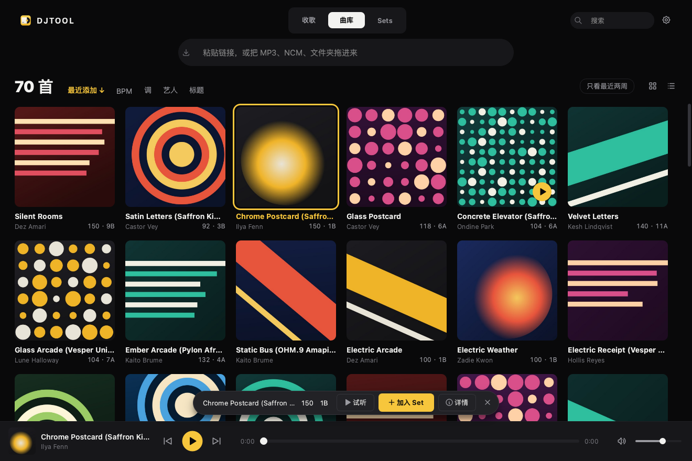
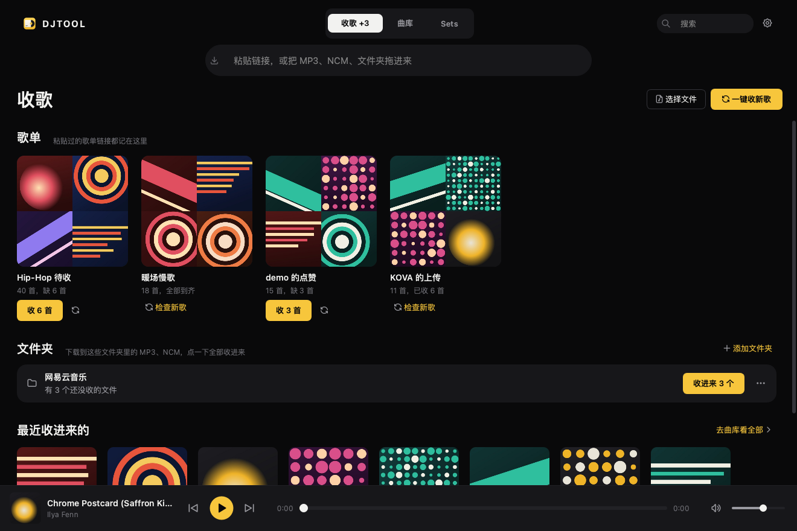
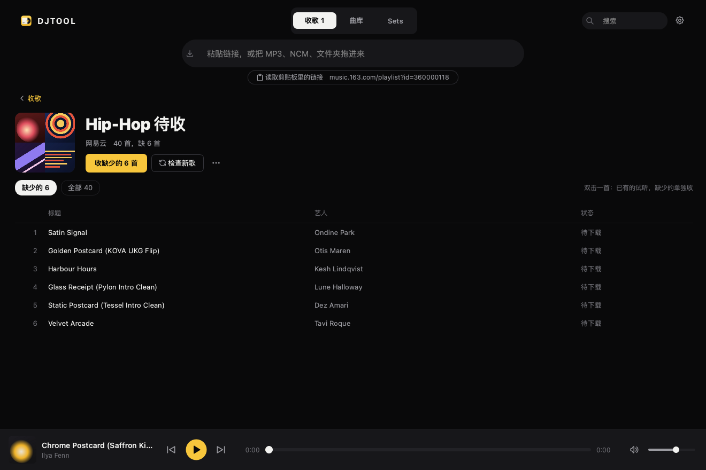
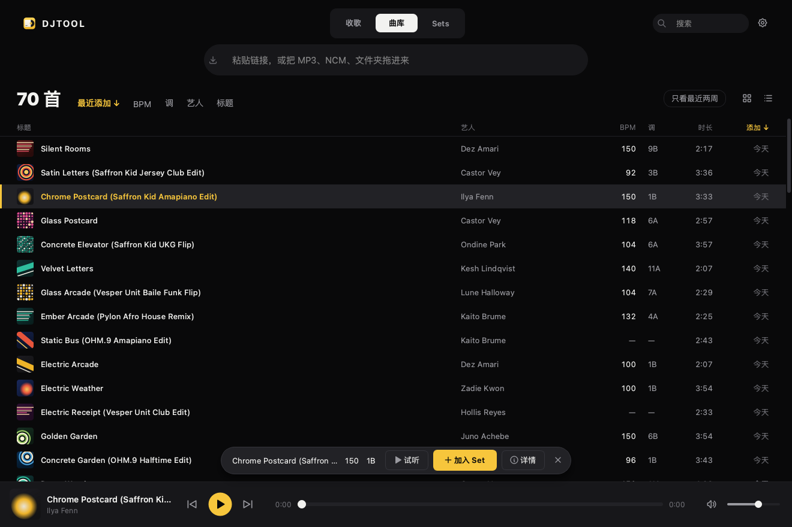
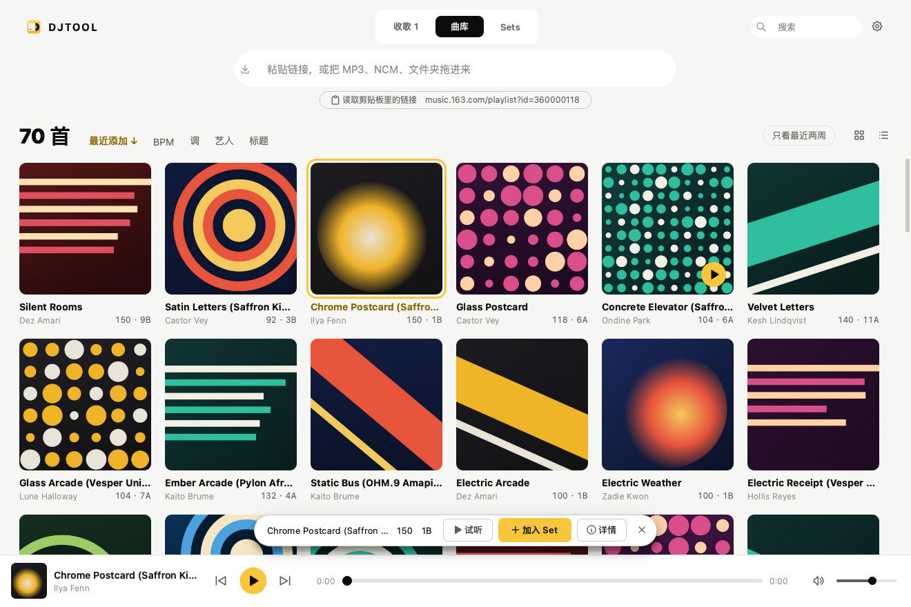
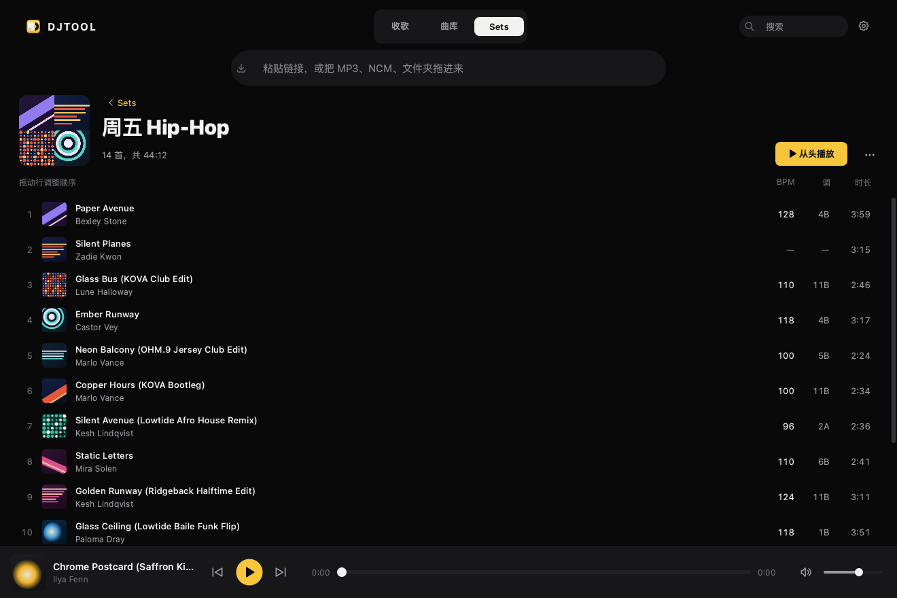

# DJTOOL

一个 Mac 本地的 DJ 收歌与曲库工具：把歌收进来，NCM 转成 MP3，整齐地放好，打开 Serato DJ Pro 就能用。



> **In English.** DJTOOL is a local macOS desktop app I built for my own DJ workflow. It collects tracks from
> playlist links, download folders and local files, converts NetEase `.ncm` files to MP3, keeps one tidy
> library, and syncs it one way into Serato DJ Pro as crates. Python 3.13, PySide6 (Qt Widgets) and SQLite;
> about 9,000 lines of application code and 278 offline tests. The interface and the rest of this page are in
> Chinese. Screenshots use a generated demo library: invented track names, programmatic cover art, silent audio.

## 它解决什么问题

我放歌用 Serato，歌从网易云歌单和 SoundCloud 上攒。原来的流程是：复制链接、下载、把 NCM 转成 MP3、
拖进 Serato、再想办法记住哪些已经收过。每一步都不难，但每周重复几十次，曲库很快就乱了。

DJTOOL 把这条线收成一件事：**告诉它歌在哪儿，剩下的它自己做完，Serato 里直接能用。**

## 功能

### 收歌：记住来源，而不是一次次复制链接



- 窗口顶部只有一个入口。粘贴链接，或者把 MP3、NCM、文件夹拖进来，都进同一个队列依次处理。
- 读过的歌单会留在收歌页上，直接显示多少首、缺几首。「一键收新歌」把每个歌单重读一遍，新加的歌直接下载。
- 支持网易云的歌曲和歌单链接，SoundCloud 的单曲、歌单、某个人的点赞页、上传页和转发页。
- 常用的下载文件夹可以挂在页面上，里面有没收过的 MP3 或 NCM 时显示数量，点一下全部收进来。
- 去重只按整文件内容或平台歌曲 ID，从不按歌名和艺人合并，所以 remix 和不同版本可以并存。



### 曲库：封面墙和列表



- 封面墙和列表共用一份数据，可以按最近添加、BPM、调、艺人、标题排序。
- 选中歌曲只在底部浮出一条操作条（试听、加入 Set、详情），版面不会被挤动。
- 试听栏占满窗口底部，进度条尽量长，整个高度都能点，方便快速跳到前奏、副歌和结尾。
- 暗色和浅色两套主题。



### Sets：排好顺序，自动变成 Serato 的 Crate



- Set 只是对曲库里同一份文件的引用，改顺序、改名都不移动音频。
- 没有“同步”按钮。Serato 关着的时候，收进来的歌和 Set 的改动会自动写成 Crate。
- BPM 和调性不由 DJTOOL 计算。它们来自 Serato 的分析结果，DJTOOL 在后台读回来显示，没有就显示“—”。

## 几个设计取舍

**一个数据边界。** `djtool/library.py` 里的 `Library` 是唯一接触 SQLite 和曲库文件的地方。界面不写 SQL，
也不直接复制音频。每次操作开一个新连接（WAL），后台线程可以各自读写；多步写入用 `BEGIN IMMEDIATE`。
音频文件和数据库不在同一个事务里，所以导入会记下本次新建的文件，失败时自己清理。

**对 Serato 只做保守的事。** 三条通路互相独立：

1. 读 BPM 和调性：把 Serato 的数据库和 WAL 复制到临时目录，在副本上只读查询，按完整路径加文件大小精确匹配。
2. 收歌 Crate：把曲库里可用的歌同步成一个固定的托管 Crate。
3. Set 到 Crate：只写自己登记过的 `.crate` 文件，写之前要求 Serato 已关闭、有同步锁、有备份，并检测外部修改。

任何时候都不写 Serato 自己的数据库，也不碰用户自己建的 Crate。真实写入还要求当前安装的 Serato 版本通过过
一次隔离验收，Serato 升级后这个许可自动失效。

**不替用户做收不回来的事。** 应用没有删除音频的功能，所以收歌文件夹默认只提示、不自动收；导入始终保留源文件；
某个人的上传页默认是“挑着收”，不参与一键收新歌。

**界面不在绘制时做重活。** 封面在后台线程解码并缓存成缩略图，没准备好先画占位；刷新只发数据变更信号，
不重建控件，所以选择和滚动位置不会丢。拖动（曲库到 Set、Set 内排序）自己处理鼠标事件，不走系统拖放。

**能离线验证的都离线验证。** 测试用合成的静音音频和临时曲库，替换掉联网和 Serato 读写。打包出来的 `.app`
带一个自检入口，同样在硬性拒绝联网、播放和真实 Serato 写入的前提下，把入库、读 BPM、写隔离 Crate、
收歌页和各个对话框走一遍。验证记录里，“合成数据通过”和“真实联网通过”是分开写的。

## 代码结构

```text
main.py                  从源码目录启动的薄入口
djtool/
  app.py                 应用入口和命令行参数
  library.py             Library：SQLite 与曲库文件的唯一边界
  intake.py  ncm.py  audio_tasks.py      本地文件：NCM 转换、校验、入库
  online.py  netease_*.py                链接收歌：读列表、下载、写标签
  intake_queue.py  watch.py  workers.py  收歌队列、收歌文件夹、后台线程
  serato.py  serato_intake.py  serato_bpm.py   三条 Serato 通路
  runtime_check.py       打包后的离线自检
  ui/                    主窗口、封面墙、收歌页、Set 页、试听栏、主题
tests/                   278 项 unittest，全部离线
scripts/                 打包、演示曲库、截图检查、隔离环境里的 Serato 实验
docs/                    需求、设计取舍、验证日志、接口与格式调研
```

## 运行

需要 macOS（Apple Silicon）、Python 3.13 和 FFmpeg（`brew install ffmpeg`）。

```bash
python3.13 -m venv .venv
```

```bash
.venv/bin/python -m pip install -r requirements.txt
```

```bash
.venv/bin/python main.py
```

第一次启动会让你选一个文件夹作为曲库。想先看看界面，可以生成演示曲库，用隔离模式打开
（隔离模式不改日常设置，也不会启动真实的 Serato 同步）：

```bash
.venv/bin/python scripts/demo_library.py work/demo-library
```

```bash
.venv/bin/python main.py --library "$PWD/work/demo-library"
```

## 测试与打包

```bash
QT_QPA_PLATFORM=offscreen .venv/bin/python -m unittest discover -s tests
```

打包成独立的 `.app`（PyInstaller，输出在 `dist/DJTOOL.app`）：

```bash
.venv/bin/python -m pip install -r requirements-build.txt
```

```bash
scripts/build_app.sh
```

打包后的离线自检：

```bash
env PATH=/usr/bin:/bin QT_QPA_PLATFORM=offscreen dist/DJTOOL.app/Contents/MacOS/DJTOOL --check-runtime work/app-check
```

## 文档

| 文件 | 内容 |
|---|---|
| [docs/PRD.md](docs/PRD.md) | 需求基线；文末较新的变更优先于前文 |
| [docs/DEVELOPMENT.md](docs/DEVELOPMENT.md) | 按版本记录的设计取舍 |
| [docs/PROGRESS.md](docs/PROGRESS.md) | 验证日志，区分离线验证和真实联网验证 |
| [docs/RESEARCH.md](docs/RESEARCH.md) | 外部接口和 Serato 文件格式的调研与实验 |
| [docs/MVP-ACCEPTANCE.md](docs/MVP-ACCEPTANCE.md) | 验收门槛 |
| [docs/FEATURE-NOTES.md](docs/FEATURE-NOTES.md) | 0.11 及之前按版本累积的功能说明（部分描述的是已删除的旧界面） |
| [CLAUDE.md](CLAUDE.md)、[AGENTS.md](AGENTS.md) | 给 AI 编程助手的协作约定：架构、界面规矩、不能破坏的产品边界 |

这个项目是和 AI 编程助手一起做的：我负责产品定义、试用和每一个取舍，助手负责实现。
上面两份约定文件和 `docs/` 里的日志就是这个协作过程的记录。

## 范围与声明

- 这是一个为我自己的工作流做的个人工具，只在我的机器（Apple Silicon、Serato DJ Pro 4 和 5）上验证过。
  发布包没有签名和公证。
- 请只用它处理你有权使用的音乐。NCM 转换针对的是你自己在网易云客户端里下载的文件。
- 网易云链接的读取和下载经过一个第三方在线解析服务，请求里会带上歌曲或歌单 ID，以及该服务检测到的公网 IP；应用不读取也不保存任何账号会话。
  SoundCloud 通过 yt-dlp 读取公开页面的播放流。这些外部服务随时可能变化或失效。
- DJTOOL 与 Serato、网易云音乐、SoundCloud 均无关联。

## 许可

代码以 [MIT 许可](LICENSE) 发布。界面图标来自 [Tabler Icons](https://tabler.io/icons)（MIT，见 `assets/icons/LICENSE`）。
