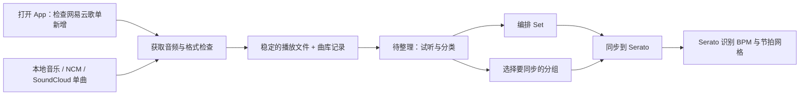

# DJTOOL 产品需求文档

版本：0.4 产品需求基线 · 2026-09-26（BPM 交给 Serato）

状态：用户已审阅需求基线；**2026-10-04 文末需求变更优先于下方历史方案**：现已选择 wyapi 在线解析与整歌单下载，移除账号与网页接收入口，音乐接入文稿/Serato，Set 不创建音频文件夹。2026-09-26 已取消 App 的 BPM 分析，交给 Serato；2026-09-23 已改为助手实现、用户试用反馈。当前实现与真实验收见 PROGRESS.md。

2026-10-04 外观追加：用户要求暗夜模式降低界面亮度。默认低亮度石墨灰，支持明暗切换并记住偏好；曲库、收歌、Set、播放器和弹窗同步更新，外观切换保留播放器状态、曲库路径与成员关系。

## 1. 产品要解决什么

一个主要在个人 MacBook 上使用的独立窗口 App，帮助 DJ 从指定网易云歌单自动接收新增音乐、知道文件在哪里、整理曲库、编排 set，并将指定分组和曲目顺序同步到 Serato。也支持本地文件与 SoundCloud 单曲入口。

最重要的体验是：**我在 App 中完成一次整理，打开 Serato 就能找到同样的分组和 set，不用再手工建立一遍。**

当前流程是“找歌 → 加入网易云歌单 → 在官方下载 → 找到本地文件 → 拖到转换网页 → 等待转换 → 再下载 MP3 → 分类”。主要痛点是输入环节的重复手工操作，以及文件管理和 Serato 分组之间的关系。

新增目标体验：**在网易云把歌加入指定歌单，下次打开 DJTOOL，它自动检查新增、获取完整音频、按需转 MP3，逐首进入待整理。** 打开 App 后任务在后台逐步完成，不承诺启动瞬间所有音乐都已就绪。

第一位用户是项目发起人，主要播放 Hip-hop，场合为 Party。旧曲库约四五百首（按用户“45百首”理解，准确数量不影响当前范围），用户希望从新曲库重新开始。先在真实使用中证明价值，再考虑向 DJ 朋友分发。市场需求目前是待验证假设，不能把个人需求直接当作市场验证结果。

## 2. 已确认与尚未确认

| 项目 | 当前结论 | 状态 |
| --- | --- | --- |
| 使用形式 | 有独立窗口的 Mac App | 用户已确认 |
| 核心价值 | 文件位置明确、分类、set 排序、同步 Serato | 用户已确认 |
| 音乐入口 | 网易云一个或多个歌单链接、本地音乐、NCM、SoundCloud 单曲链接 | 用户已确认；联网读取与下载能力待验证 |
| 网易云触发方式 | 每次打开 App 自动检查已订阅歌单的新增歌曲 | 用户新增明确需求 |
| BPM | 由 Serato 识别；App 不分析、不提供校正流程，只保留文件已有标签 | 用户于 2026-09-26 明确变更 |
| 常用输出 | 优先统一为 MP3 | 用户偏好已确认；编码策略为建议 |
| SoundCloud 歌单 | 好实现再加，不影响单曲优先级 | 用户已确认 |
| 当前存储 | 音乐基本在 Mac；曾遇到 U 盘加载极慢 | 用户提供；原因未诊断 |
| 设备 | Hercules T7；U 盘型号未知，直插还是扩展坞已记不清 | 用户提供 |
| 当前软件 | 本机 `/Applications/Serato DJ Pro.app` 版本为 4.0.9 | 已只读检查应用版本信息 |
| 曲库起点 | 从新曲库开始，不要求迁移旧曲库 | 用户已确认；不包含删除旧文件的操作 |
| 同步方式 | 第一版 App → Serato，关闭 Serato 后手动同步 | 用户已确认；实现待技术验证 |
| 技术路线 | 当前采用 Python + PySide6 + SQLite | 本地工作台已实现，后续按实测调整 |
| 开发方式 | 助手实现和推进，用户负责试用、反馈和视觉决策；稳定后集中讲原理 | 用户于 2026-09-23 更改 |

## 3. 文件、分类与 set 的关系

| 概念 | 含义 | 例子 |
| --- | --- | --- |
| 音乐文件 | 硬盘上实际用于播放的音频，位置应当稳定 | 一首 MP3 |
| 曲库记录 | 记住这首歌的身份、文件位置、来源与音乐信息 | 曲名、艺人、时长、路径 |
| 来源歌单 | 在网易云用于收集候选曲目的订阅入口 | 网易云“DJ 待选”歌单 |
| 标签 | 描述歌曲，可以有多个，允许暂时不填 | House、温暖、能量 2、人声 |
| 分组 | 为选歌组织的一组歌曲，可加入多个分组 | 暖场备选、近期收藏 |
| Set | 为一次演出或练习编排的有序歌曲列表 | 周五暖场，第 1–15 首 |

一首歌可以同时存在于多个分组和 set 中，引用同一份播放文件。调整分类或 set 顺序不移动、重命名或复制播放文件。

来源歌单负责收集候选歌曲；App 内的分组和 set 负责本地整理与演出编排。远端歌单的排序不自动覆盖已经编好的 set。

针对 Hip-hop Party，建议先提供三个可选分类维度：子风格、主观能量（1–5）、适用阶段（暖场 / 升温 / 高峰 / 收尾 / 备用）。无需每首歌填满，能量由用户试听判断。Clean/Explicit、Intro/Edit 等版本差异可作为补充标签，不从歌名武断推断。

这些是起步建议，随真实选歌习惯调整。标签不强制自动变成 Serato 分组；只同步明确选择的分组与 set。第一场练习可建立一个“Party 01” set，用备注记录候选衔接想法。

## 4. 第一版的完整使用流程

1. 从空曲库开始，选择新增音乐的存放位置；默认建议 Mac 本地 `~/Music/DJTOOL`，实际路径在首次使用时确认。
2. 添加一个或多个网易云歌单链接，完成必要的登录和首次接收范围设置；也可添加 MP3、拖入 NCM 或粘贴 SoundCloud 单曲链接。
3. 每次启动后自动检查歌单新增；后台任务逐首获取音频、校验、按需转换，完成后进入“待整理”。
4. 查看来源、实际格式和文件位置，试听、添加标签、加入分组。
5. 新建一个 set，将歌曲加入并拖动排序；可以随时试听和记录衔接想法。
6. 预览将同步的分组、set 和变更，执行同步。
7. 打开 Serato，检查相同的名称、曲目成员与自定义顺序，并能实际加载播放。

第 6–7 步是第一版的必要验收条件。仅在 App 内显示列表或生成导出文件，不能算完成 Serato 同步。

### 4.1 网易云歌单接收规则

- 添加歌单链接后记录歌单身份、名称、曲目来源 ID 和最近一次成功检查时间。第一版支持多个歌单，底层先用一个小歌单验证。
- 首次接入展示当前曲目数量和已有记录，设置接收全部当前歌曲，或仅接收以后新增；后续每次打开无需重复选择。
- 启动时异步检查，提供“立即检查”、暂停与重试。第一版不要求 App 退出后继续下载，也不添加系统后台常驻任务。
- 同一网易云歌曲同时出现在多个来源歌单时共用一份本地播放文件，并保留所有来源关系。不能仅按歌名合并不同版本，也不自动跨平台匹配同名曲。
- 歌单排序和改名更新来源信息；歌曲从歌单移除、歌单停用或变为不可访问时，保留已下载音频、分类与 set。一次网络错误或不完整列表不能被当作远端删除。
- 接收记录与处理完成状态分别保存；上次未完成任务可继续或重试。人工忽略的歌曲不在每次启动时反复加入。
- 断网时使用已有曲库并显示最近成功检查时间；登录失效时只暂停需要账号的任务；单曲失败不阻塞其他歌曲。暂时错误有限重试，权限问题等待用户处理。
- 任务状态可见：发现新增 → 等待音频 → 获取中 → 校验/转换中 → 待整理。转换和校验完成后直接进入待整理，不等待 BPM 处理。
- 账号连接优先评估用户自行扫码；登录凭据仅本机保存，不要求用户粘贴到聊天或公共解析网站。具体登录方案待验证。

### 4.2 自动获取音频的可行性关口

目标是“歌单链接 → 自动取得音频”。读取歌单列表成功不等于能下载其中所有完整歌曲；账号下载权限、单独购买、地区、曲目可用状态、接口变化均需在真实样本中核实。会员状态本身不是全部曲目可下载的证明。

有可用的完整音频时按真实格式进入后续流程；不强制绕一遍 NCM。只有实际输入为 NCM 才执行 NCM 提取步骤。获取不到完整音频时保留曲目与具体原因，不把试听片段或其他来源的同名歌当作成功。

候选过渡方案：用户在网易云官方 App 点下载，DJTOOL 接收指定下载目录中的新文件，自动转 MP3 并入库。它能减少后续拖拽与网页操作，但仍保留官方下载动作，**不能据此宣称已完成歌单全自动下载**。是否采用等待用户反馈；目录接收仅处理写入完成并可校验的文件。

### 4.3 BPM 职责（2026-09-26 变更）

- BPM 识别、波形与 Beatgrid 由 Serato 完成，DJTOOL 不运行任何 BPM 分析器。
- 移除自动分析、批量/单曲分析、估计/待校正状态、BPM 筛选和人工校正控件。所有音乐入口校验/转换后直接入库。
- 文件已有 BPM 是元数据，可以只读展示；旧数据库中的人工值和历史估计保留，不删除原文件信息，但历史估计不再作为当前结果使用。
- BPM 分析库不再属于安装或打包依赖；不再设置算法准确率验收门槛。

## 5. 功能范围与验收条件

| 功能 | 第一版要求 | 验收方式 |
| --- | --- | --- |
| 本地音乐导入 | 添加 MP3 文件或文件夹，复制到新曲库后读取基本信息；显示播放文件实际位置并能在 Finder 中定位 | 添加后重启 App，歌曲和位置仍可用；输入文件保留 |
| 新音乐存放 | 下载和转换的播放文件进入用户选定目录；命名冲突不覆盖 | 同名不同音频可以并存 |
| 网易云歌单订阅 | 保存多个歌单链接，启动后检查新增，记录来源和任务结果 | 添加一首歌后重开 App 可发现；再次重开不重复建立任务 |
| 网易云音频获取 | 获取可用完整音频并自动送入处理流程 | 小歌单真实验证下载、时长与曲目版本；仅能读歌单不算通过 |
| 重复处理 | 识别完全相同文件和已处理的平台曲目 ID；保留多个歌单来源 | 重复导入不悄悄生成第二份；不同 remix 不按歌名合并 |
| NCM 处理 | 本地提取音频，识别真实格式，按 MP3 策略处理，保留来源文件 | 分别验证内含 MP3、内含 FLAC 和损坏 NCM；实际输出可播放 |
| SoundCloud 单曲 | 粘贴链接、解析信息、取得可用完整音频、进入统一接收流程 | 用具体真实链接验证；失败能解释原因并重试，不将试听片段标为完整歌曲 |
| 曲库浏览 | 歌名/艺人搜索，标签筛选，查看来源、时长和位置 | 能在实际测试曲库中找到指定歌曲 |
| 试听 | 单曲播放、暂停、拖动进度；支持比较候选曲 | 不需要为每次选歌跳到其他应用 |
| 标签与分组 | 手动添加、编辑标签，创建/重命名分组，增减成员 | 一首歌属于多个分组时，播放文件不增加 |
| Set 编排 | 创建/重命名 set，添加/移除歌曲，拖动排序，逐曲备注 | 两个 set 可对同一首歌安排不同顺序，重启后保留 |
| Set 时长 | 显示曲目时长之和 | 明确称为“曲目总时长”，不当作考虑混音重叠后的演出时长 |
| Serato 同步 | 同步选定分组、set 名称、成员和顺序 | 在本机 4.0.9 实际打开并播放，修改顺序后再次同步仍一致 |
| 状态与恢复 | 缺失文件、离线磁盘、处理失败、未同步与冲突有明确状态 | 失败不丢掉已完成的整理工作，不把半成品标为可用 |

已有调性与 BPM 标签可以读取并保留，缺失则留空；App 不分析 BPM。新音乐的 Serato 波形、节拍网格分析与 Cue 点设置仍由 Serato 完成。

## 6. MP3 与文件存放策略

以下是建议，编码参数在音频验证阶段最终确定：

- 新建播放文件优先 MP3；已经是 MP3 的音频尽量保留音频流，避免重复有损编码。
- NCM 中若是 FLAC，提取后再生成 MP3 播放副本。不能只修改后缀。
- 需要编码时可先评估 320 kbps 设置；它是输出参数，不是源音质保证。低质量输入不会因输出数字增大而恢复细节。
- 原始输入不自动删除。来源格式、实际输出格式、编码处理情况可追溯；不承诺任何 SoundCloud 链接都能取得高音质原文件。
- 新曲库拥有统一的播放文件目录。导入已有 MP3 时复制进去并保留输入；下载和转换也进入该目录。每首歌在此曲库只有一份选定的播放文件，源文件与备份另行区分。
- 旧曲库迁移不是第一版要求；若日后选择迁移，再处理原有 Serato 引用。重建曲库不等于删除旧音乐文件。
- 分类、歌名显示调整和 set 排序均不自动改变硬盘路径。使用稳定的内部歌曲标识，而不是依赖歌名区分歌曲。
- 第一版日常使用优先本地存储，是基于用户目前本机加载正常的工作选择；不是对 U 盘问题的诊断。

## 7. Serato 同步约定

用户已接受：**App 负责已托管分组与 set → 用户关闭 Serato → App 同步 → 打开 Serato 使用。** 以下管理范围和保护细节是实现建议。

1. 首个目标为本机 Serato DJ Pro 4.0.9；其他版本需要单独验证。
2. 建议在 Serato 内使用一个清楚标识的 `DJTOOL` 父分组，只管理其下由 App 创建的分组和 set。
3. 第一版同步名称、成员和曲目顺序。App 自定义标签、能量、set 备注暂不承诺映射到 Serato 字段。
4. App 中更改过的分组可再次同步，重复同步不会不断增加同名分组；移除成员不会删除音乐文件。
5. 删除整个已同步分组时先展示待删除项目；仅作用于 App 管理的分组。其他 Serato 分组不属于同步范围。
6. 写入前检查 Serato 状态、文件可用性和自上次同步后目标数据是否改变；遇到外部修改先报告冲突，不静默覆盖。
7. 首次接入先完成版本对应数据的备份与恢复验证；写入失败能恢复到上一份完整状态。具体备份对象取决于验证后的同步方案。
8. 现有 Cue 点、Loop、Beatgrid 等数据必须保留。接入实验采用测试文件与隔离的测试库，不能用原始曲库试错。

**目前只确认 Serato 有分组和排序能力，尚未验证第三方 App 的可靠同步路径。** 不能假定写入旧版 `.crate` 文件即可让 4.0.9 自动同步；文件格式、导入机制、排序显示和重复更新行为需要实测。

## 8. 界面方向

建议采用三个主要工作区：“待整理”“曲库”“Sets”。“待整理”可管理来源歌单，显示正在接收与已就绪歌曲、来源和失败原因。Serato 同步入口显示在当前分组或 set 的上下文中；存储位置和任务详情可直接查看。

选歌时同时看见曲库与当前 set，减少来回切换。试听控制在浏览与编排时保持可达。文件位置、任务状态、空值和未完成事项表达清楚。

视觉语言、颜色、排版和交互细节由用户参与定义；在功能关系确定后单独做少量设计草图，挑选方向。独立窗口是使用体验选择，数据可靠性还需靠文件管理与恢复机制实现。

## 9. 第一版暂缓

- SoundCloud 整张歌单批量下载、后台追踪收藏更新。
- 双向或实时 Serato 同步、多台电脑同步、云端账号。
- 自动曲风判断、AI 自动排 set、自动混音、Stems 分离。
- BPM 分析和校正、自动调性分析、在 App 内编辑 Serato Cue 点和 Beatgrid。
- App 退出后的常驻下载、修改网易云远端歌单、将歌单移除动作同步为本地文件删除。
- 原曲库全量迁移、复杂音频指纹去重、多品牌 DJ 软件兼容。
- 公共商店发布、商业收费和团队协作。

这些不是永远不做；先用真实使用验证“管理 → 排序 → Serato 可用”的完整流程。

## 10. 建议架构与选择理由

| 部分 | 初步选择 | 用户将理解的内容 |
| --- | --- | --- |
| 核心逻辑 | Python | 路径、函数、数据模型、错误处理、任务执行 |
| 独立窗口 | PySide6，先评估 Qt Widgets | 界面事件如何调用逻辑，耗时任务如何避免卡住窗口 |
| 本地记录 | SQLite | 歌曲、分组、成员和顺序怎样持久保存 |
| 音频工具 | 按需集成解码器、FFmpeg/ffprobe、元数据工具 | 提取、探测、转码、音频流与标签的区别 |
| 接收任务 | 本地保存歌单快照、来源 ID 和处理状态 | 如何找新增、避免重复、处理失败与重启 |
| 外部连接 | 网易云、SoundCloud 与 Serato 各有独立模块 | 外部工具变化如何不影响曲库与 set 核心逻辑 |

这是候选方案，不在此阶段锁定依赖版本。PySide6 是 Qt 官方 Python 绑定，可让主流程继续使用 Python；旧桌面项目使用 PyQt6，二者不能不加检查地直接混用。[Qt 官方文档](https://doc.qt.io/qtforpython-6/)

暂时不需要云服务器、云数据库或网站部署。网易云社区适配器若需要额外运行时，应封装成本机辅助进程并评估打包成本；尚未决定引入。窗口、核心逻辑、存储和外部连接分别承担清楚的职责，避免把全部逻辑继续堆进一个界面文件。

## 11. 实现与学习里程碑

具体阶段顺序、协作分工、验收方式和第一轮任务见 [DEVELOPMENT.md](DEVELOPMENT.md)。本节保留产品层面的里程碑概览。

| 阶段 | 可见成果 | 用户练习重点 |
| --- | --- | --- |
| 0. 定稿 | 审阅 PRD；加入歌单收件箱，核实账号与样本 | 能说清来源歌单、文件、曲库记录、分组和 set 的区别 |
| 1. 第一个窗口 | 选入几首测试 MP3，显示歌名和真实路径 | 写一个读取路径/信息的小函数，理解输入与返回值 |
| 2. 网易云可行性实验 | 小歌单可读、实际音频可取；分别记录覆盖范围与失败 | 理解歌单元数据与音频获取是两个步骤 |
| 3. Serato 可行性实验 | 一个测试 set 在 4.0.9 中保持成员和顺序，修改后可更新 | 理解 App 数据与外部软件之间的转换和验证 |
| 4. 自动待整理 | 启动检查新增、转换、显示结果、重启去重 | 亲手写新增歌曲判断和状态变化，理解自动化的数据依据 |
| 5. 曲库与编排 | 分类、试听、排序、重启保存，接入 SoundCloud 单曲 | 亲手实现分组成员操作与 set 顺序保存 |
| 6. 完整个人使用版 | 一次真实 set 准备与 Serato 使用，完成桌面打包 | 检查恢复机制、日志和完整交付流程 |

网易云获取和 Serato 同步实验都安排在主体开发早期。若不能满足自动化目标，先调整方案并重新讨论 PRD，不能默默把“仍需手工操作”当成已经实现全自动。SoundCloud 同样以真实样本结果为准；若下载范围受限，明确记录实际支持边界。

当前合作节奏：助手负责实现、检查和推进，用户负责实际使用、调试反馈与产品感觉。原理讲解安排在产品稳定后，不再用函数练习阻塞实现。中文注释持续说明目的、输入输出和关键取舍；可运行与用户已理解仍是不同结论。本节表格中的练习重点作为后续讲解主题保留，不再作为开发前置条件。

理解每个环节指理解输入、输出、职责、取舍与错误如何传播；无需先重写成熟的音频编解码器才能开始项目。作品集材料来自已运行、已验证、能独立解释的实际成果。

## 12. 完整验收场景

先以约 20 首测试歌曲、3 个分组和 2 个 set 验证完整流程。曲库浏览按约 500 首的起步规模验证；实际响应耗时在用户的 Mac 上记录，不预先声称性能已达标。

1. 包含中文/空格文件名、同名不同歌曲、重复文件、缺失元数据、损坏文件；错误被区分并记录。
2. 同一首歌加入多个分组与 set，播放文件不因分类而增加副本。
3. 修改两个 set 的顺序，关闭再打开 App 后仍一致；删除一个 set 的成员不影响另一个 set。
4. 按确认的流程同步后，在 Serato 4.0.9 中看到正确名称、成员、顺序且能播放；再改一次顺序、再同步，仍正确。
5. Serato 自定义曲序与按 BPM/歌名临时排序的显示差异要在实测中确认，不能把临时列排序误认为 set 顺序丢失。
6. 缺失歌曲、外置盘离线、磁盘空间不足或同步失败时，不留下虚假的成功状态；恢复后已有整理结果仍在。
7. App 管理范围外的曲库和测试前已有的表演标记保持不变。
8. 小歌单加入一首歌后重开 App，能自动发现、取得完整音频、按需转 MP3 并进入待整理；单纯显示歌名或需要手动拖文件不算全自动验收通过。
9. 两个歌单包含同一歌曲、反复启动、处理中退出再打开，都不会产生重复播放文件；远端移除歌曲不影响已有 set。
10. 登录过期、列表获取不完整、单曲不可下载与转换失败分别呈现，不互相冒充；断网不阻塞已存在的曲库。
11. 所有入口均不启动 BPM 分析；移除前的元数据与旧库记录保留，整理其他字段不会覆盖历史人工值。

以上是完整产品验收项。已完成的本地测试与未完成的真实外部验收，分别记录在 PROGRESS.md；不能据本地测试宣称完整 PRD 已通过。

## 13. 后续验证所需信息

- 已收到网易云 DJ 歌单并验证公开元数据可读；会员已由用户确认，完整下载仍待验收。不收集密码或登录凭据到聊天中。
- 若直连下载暂时不稳定，是否接受“官方点下载 → App 自动接收处理”的过渡流程？这项偏好等待用户反馈。
- 已收到 SoundCloud Counting 编辑版单曲链接，作为下载实验样本。
- 首次使用前选择新曲库目录；当前建议 `~/Music/DJTOOL`，尚未创建该目录。
- U 盘问题单独排查时再读取型号、格式和连接状态，不要求用户现在回忆准确。
- 编排界面设计时，用一个真实 Party 场景判断标签是否够用，并由用户选择视觉方向。

这些信息不妨碍 PRD 的核心范围成立；相关能力须在对应阶段验证后才能标为完成。

## 14. 依据与验证边界

两个旧项目与平台适配器的研究见 [RESEARCH.md](RESEARCH.md)。2026-09-26 已按用户要求移除 BPM 功能；本地导入、NCM 转换、元数据、Set 与 SoundCloud 既有功能保留，验证见 [PROGRESS.md](PROGRESS.md)。网易云登录仍未通过，不以本地目录接收替代这一目标。Serato 已读取隔离副本做结构研究，未修改真实曲库，写入同步仍待验收。

## 2026-10-04 需求变更：音乐位置与 Set 分离

此节替代此前账号接入和 Set 文件夹方案。用户选择仅本机运行 Netease_url 开源代码直连网易云；不采用 wyapi/nextmusic 在线解析。收歌页移除会员会话、账号、网页接入设置和官方下载接收入口，改为参考图的白色封面表格，每页十首、逐首操作。匿名完整音频获取仍以实测为准，不把网页演示站能力当作开源版本能力。

已有 Serato 音乐保留在「文稿/Serato」，新音乐统一保存至其中 DJTOOL Audio 子目录。已有歌曲按原路径登记，不搬迁、不改写标签；DJTOOL 已有记录和 Set 保留。Set 是歌曲引用、排序与备注，系统中不创建同名音乐文件夹。同步到 Serato 的 DJTOOL/Set Crate，只修改 App 托管的列表文件，先验证隔离创建、重开、更新、再重开和恢复，不直接改写用户 Serato 数据库。

### 同日追加：改用在线站、全歌单下载

用户撤回仅本机直连选择，要求使用 wyapi 网站解析下载。页面可按十首显示，下载整个歌单必须覆盖该链接全部歌曲，不采用网页每页十首 ZIP 的操作限制。已入库歌曲复用；进度必须展示全歌单数量与成功/失败/剩余，可停止、重试。服务限额和音源不可用仍按实际响应处理，不换 IP 或把失败当完成。歌曲 ID 和站点检测的公网 IP 按服务协议传输；不提交用户网易云账号或 Cookie。

### 同日追加：大歌单自动筛重与待整理

粘贴千首级歌单后自动核对已下载音乐，显示已有/缺少数量，默认只列待下载；一键按原顺序下载全部缺少歌曲，新入库进入待整理。已有音乐保持整理状态、分类、Set 和备注，跨歌单与重启不重复下载。依据必须是精确平台歌曲 ID 或文件内容，不按同名推断不同版本。未知来源的旧音频须说明无法提前识别；已关联文件缺失单独提示恢复，不虚报已有可用音频。

### 同日追加：读取 Serato BPM，供选曲和排歌查看

用户要求将 Serato 已保存的 BPM 读取到 DJTOOL，在曲库、当前 Set 与歌曲详情查看。此变更仅增加 Serato 数据来源的手动只读同步和显示，2026-09-26 取消的 App 自行分析、BPM 筛选与校正仍不恢复。曲库页面与设置中提供「读取 Serato BPM」，缺值显示「—」，保留小数精度并标明来源为 Serato。新歌先在 Serato 分析，再手动更新；不承诺自动或实时分析同步。

首个支持范围为本机 Serato 4.0、schema 202 的根卷数据库。按完整播放路径与实际文件大小核对，只接收有效音频记录；不凭歌名猜测，不将旧标签或历史估计作为缺值替补。外置卷和流媒体另行验证。源库与 WAL 仅复制到临时私有目录，在副本中查询；不写 Serato 数据库、音频标签、Cue 点或 Beatgrid。DJTOOL 独立缓存保留来源和更新时间，成功完整读取清理旧空值；失败、取消和未知版本保留上次结果。验收须分别检查真实已有数据、隔离事务与界面显示，不把读取现有值当成新歌已经完成分析。

### 2026-10-23：收歌后自动加入 Serato

下载或本地导入成功的歌曲，无论是否整理，都应自动加入 Serato 的 DJTOOL / 收歌；先前已收进来的可用歌曲也补同步。待整理、分类与 Set 的成员、顺序和备注完全独立，不要求创建 Set，不额外复制音频。

Serato 打开时不写入托管 Crate；保留待同步，关闭后 DJTOOL 自动继续，下次启动 Serato 接收。DJTOOL 保持打开时每 15 秒核对，也在导入和下载批次完成后立即检查；退出 DJTOOL 后以持久曲库记录恢复待同步。界面区分等待关闭、已准备导入、原生 Serato 已接收，缺失文件单列且不阻塞其他歌曲。真实写入仍要求当前安装与隔离原生验收相符；不直接修改 Serato SQLite、原音频或用户列表。

### 2026-10-23：批量加入 Set

用户新下载一百多首千禧年电子歌曲，逐首加 Set 过于繁琐。曲库/待整理须支持 Shift 连选、⌘ 多选、当前筛选结果全选和一次加入右侧目标 Set，显示选择数量。新成员按当前可见列表顺序追加，已有成员不重复、不移动，原备注、其他分组/Set、待整理标记和文件路径不变。多选拖入指定位置也应整批处理，不能悄悄只加一首。

同一歌单的已下载歌曲可在收歌页直接批量入当前 Set，采用当前原序范围内全部页面，不受每页十首或“只看待下载”的显示筛选限制；只采用成功入库且文件仍在的记录，按原歌单顺序去重。此操作不重新下载、不创建 Set 音频文件夹，也不自动推送用户 Set 到 Serato。
